# ЛР 1. Loki + Zabbix + Grafana

**Задача:** подключить к Nextcloud логирование (Loki + Promtail) и мониторинг (Zabbix), вывести данные в Grafana.

**Файлы:** [`docker-compose.yml`](docker-compose.yml), [`promtail_config.yml`](promtail_config.yml), [`template.yml`](template.yml)

## Часть 1. Логирование

Запуск стека и проверка контейнеров:

```bash
docker compose up -d
docker ps
```

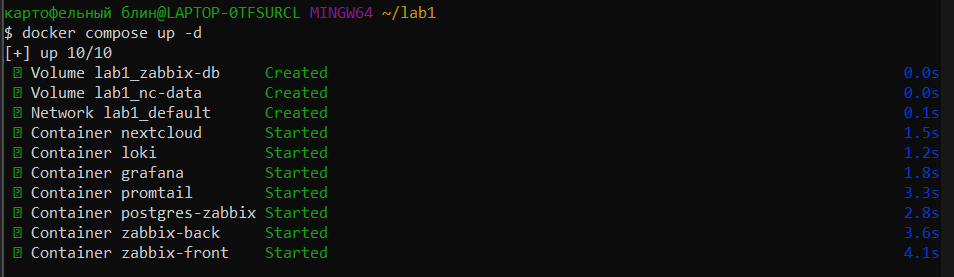

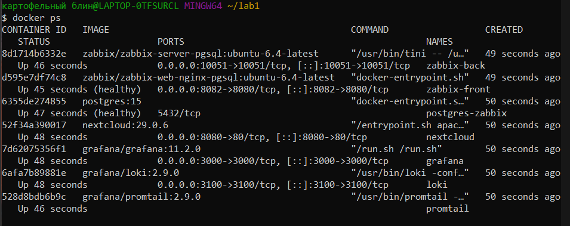

Nextcloud инициализирован на http://localhost:8080:

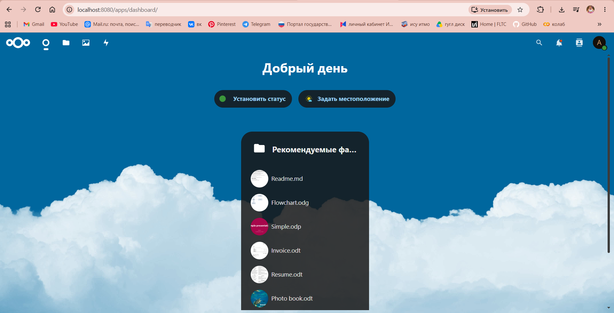

Логи пишутся в `/var/www/html/data/nextcloud.log`:

```bash
docker exec -it nextcloud bash -c "ls -la /var/www/html/data"
docker exec -it nextcloud bash -c "tail -n 5 /var/www/html/data/nextcloud.log"
```

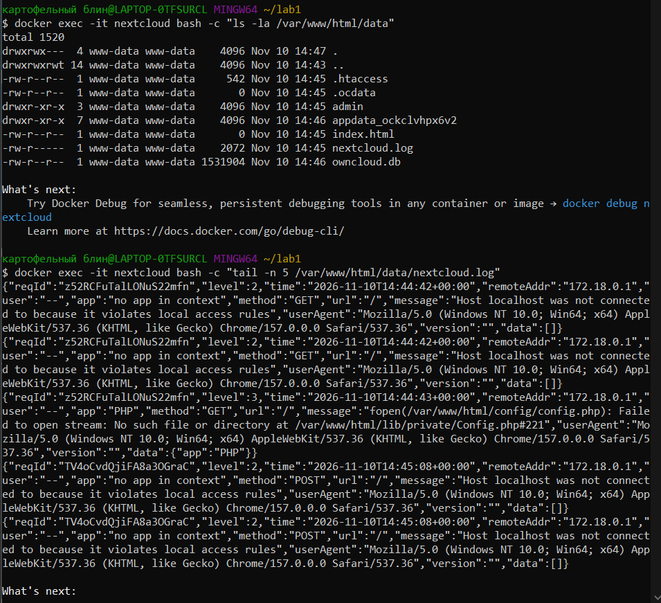

Promtail подхватил лог-файл (`Seeked /opt/nc_data/nextcloud.log`):

```bash
docker logs promtail 2>&1 | grep Seeked
```

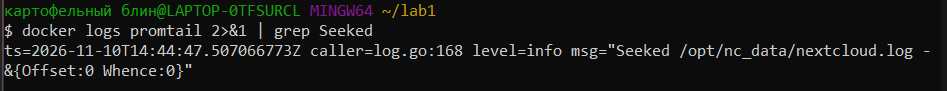

## Часть 2. Мониторинг

В Zabbix (http://localhost:8082, Admin / zabbix) через *Data collection → Templates → Import* импортирован шаблон `template.yml`:

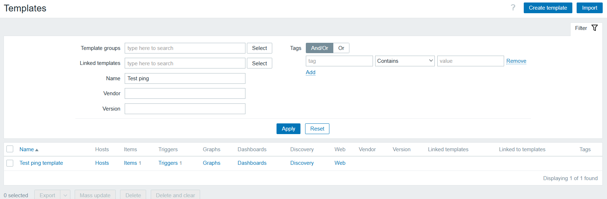

Имя `nextcloud` добавлено в доверенные домены Nextcloud:

```bash
docker exec -u www-data -it nextcloud php occ config:system:set trusted_domains 1 --value="nextcloud"
```

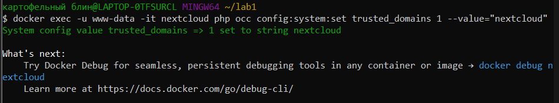

Создан хост `nextcloud` (группа Applications, шаблон Test ping template):

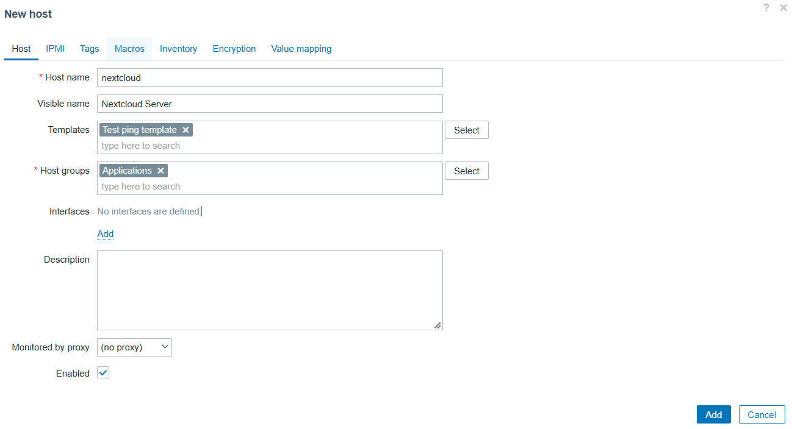

В *Monitoring → Latest data* получено значение `healthy`:

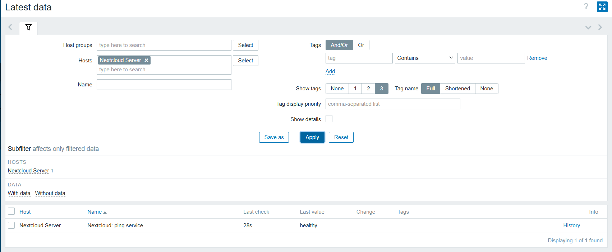

## Часть 3. Визуализация

Установлен и включён плагин Zabbix для Grafana:

```bash
docker exec -it grafana bash -c "grafana cli plugins install alexanderzobnin-zabbix-app"
docker restart grafana
```

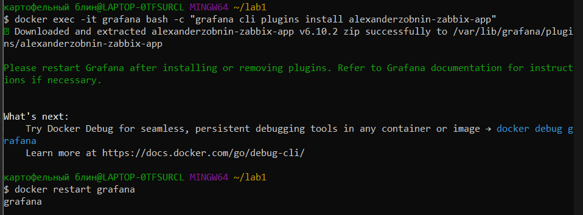

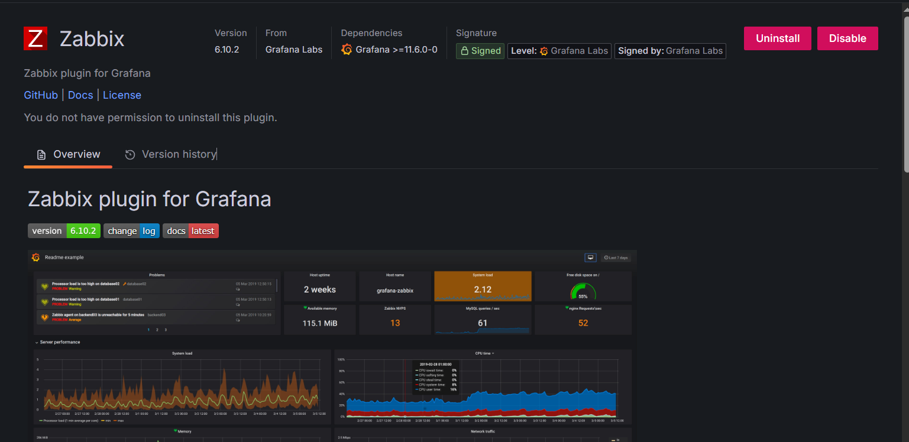

Подключён источник данных Loki (`http://loki:3100`):

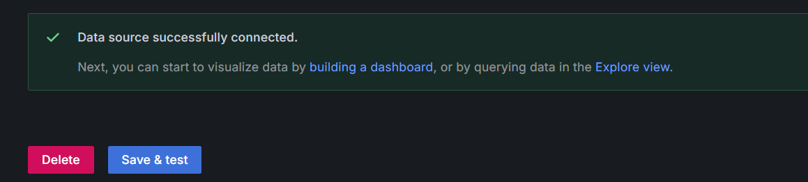

Подключён источник данных Zabbix (`http://zabbix-front:8080/api_jsonrpc.php`):

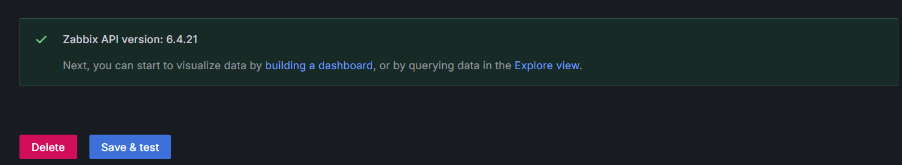

Логи Nextcloud в Explore (`job = nextcloud_logs`):

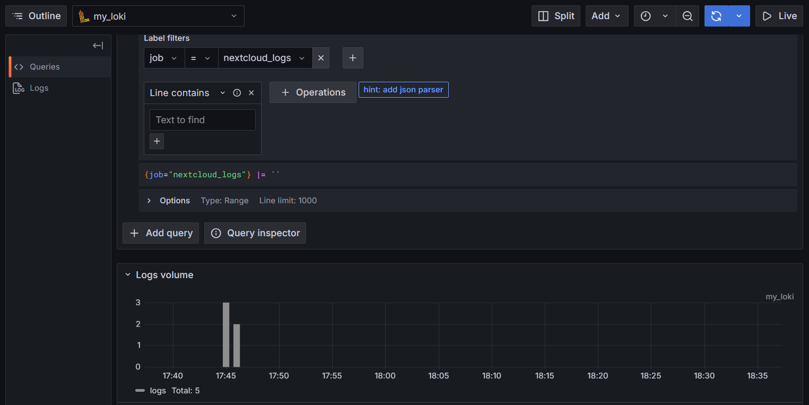

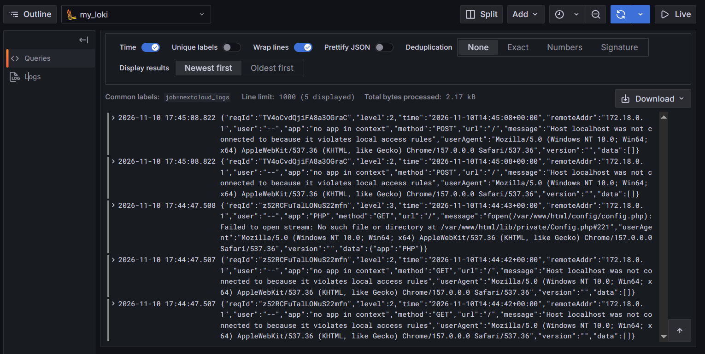

Данные Zabbix в Explore:

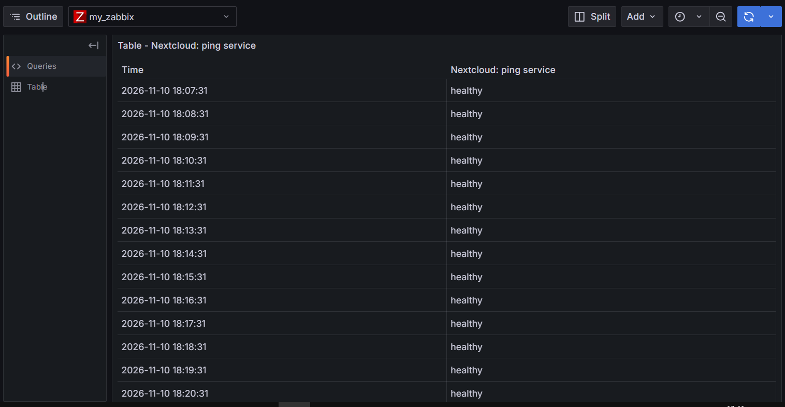

## Задание

### Запросы LogQL

Все логи:

```logql
{job="nextcloud_logs"}
```

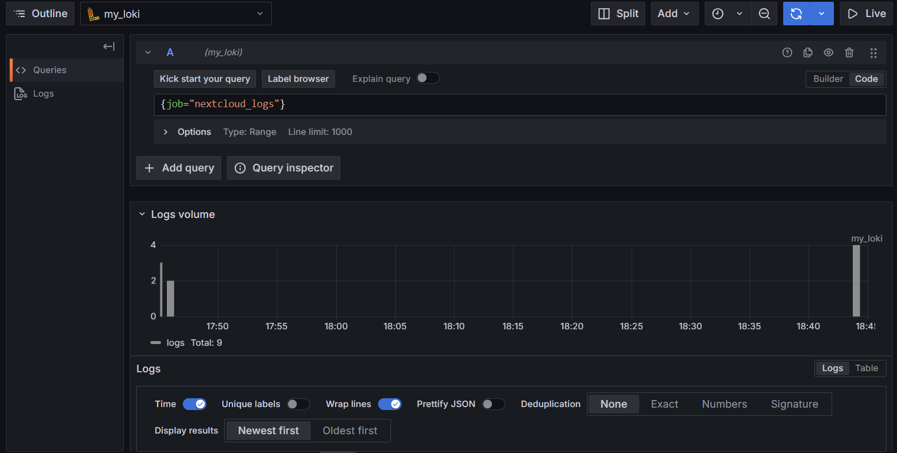

Только неудачные входы:

```logql
{job="nextcloud_logs"} |= "Login failed"
```

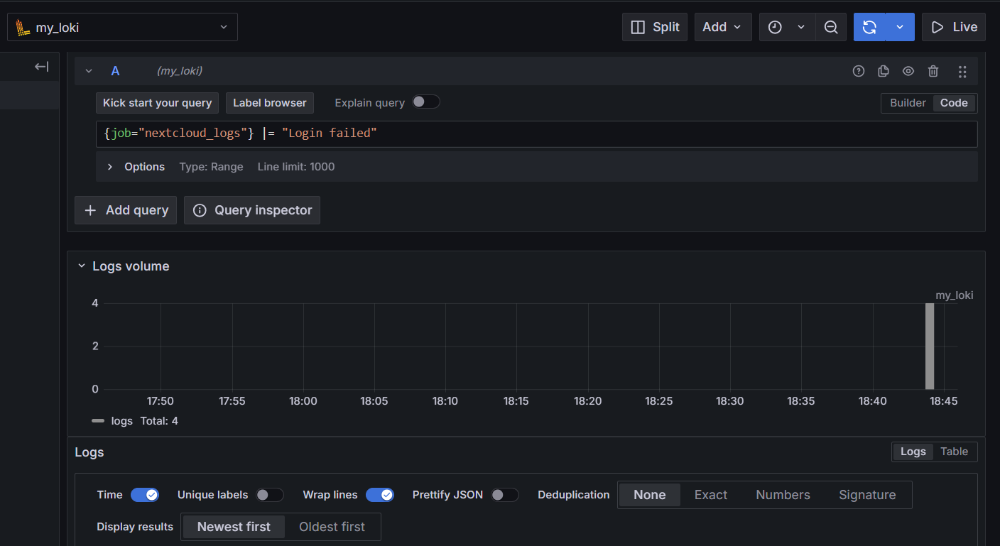

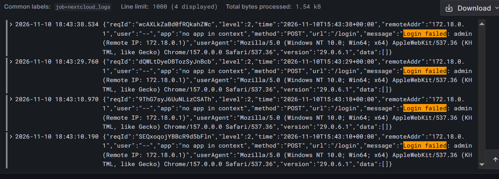

Разбор JSON, вывод времени и сообщения:

```logql
{job="nextcloud_logs"} | json | line_format "{{.time}} {{.message}}"
```

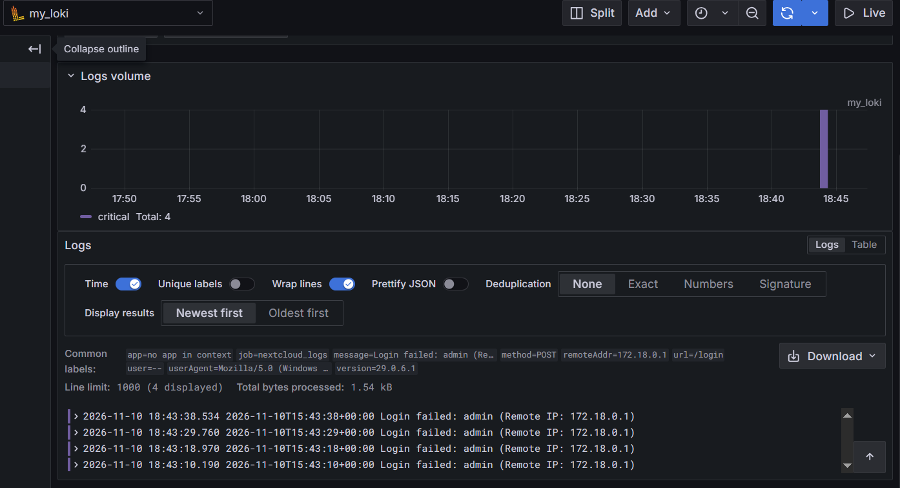

Количество строк лога за 5 минут:

```logql
count_over_time({job="nextcloud_logs"}[5m])
```

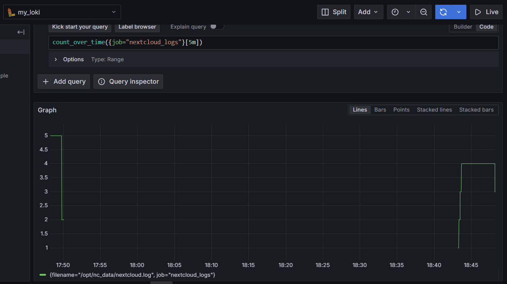

### Дашборды

Статус Nextcloud (Zabbix, Stat + value mappings):

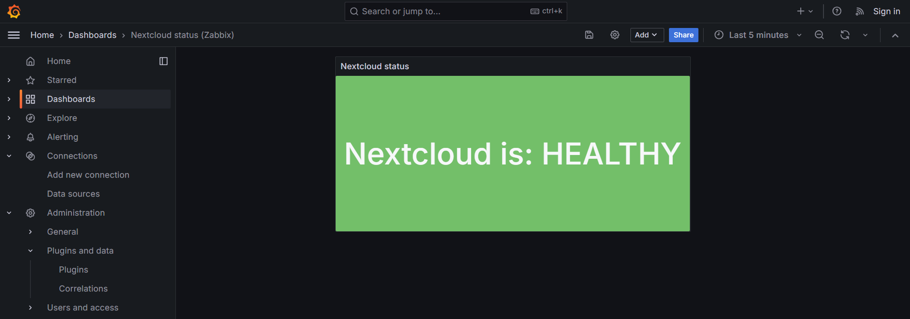

Логи Nextcloud (Loki, Table):

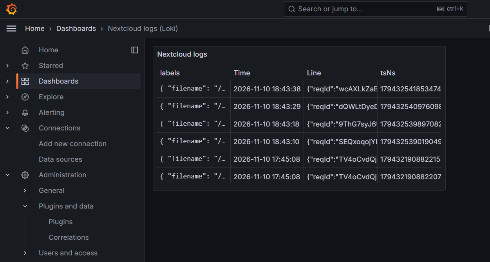

## Ответы на вопросы

**1. Чем SLO отличается от SLA?**
SLA — договор с клиентом о гарантированном уровне сервиса со штрафами за нарушение. SLO — внутренняя целевая метрика команды (например, 99,9 % успешных запросов за месяц). SLO обычно строже SLA.

**2. Чем отличается инкрементальный бэкап от дифференциального?**
Инкрементальный копирует изменения с последнего бэкапа любого типа: копии маленькие, но для восстановления нужна вся цепочка. Дифференциальный копирует изменения с последнего полного бэкапа: копии растут, но для восстановления нужны только полный и последний дифференциальный.

**3. В чем разница между мониторингом и observability?**
Мониторинг отслеживает заранее заданные метрики и сообщает, что что-то сломалось. Observability позволяет по метрикам, логам и трассировкам понять, почему сломалось, в том числе при непредвиденных проблемах. Мониторинг — часть observability.

## Вывод

Логи Nextcloud собираются в Loki, доступность отслеживается Zabbix, данные выведены на дашборды Grafana.
